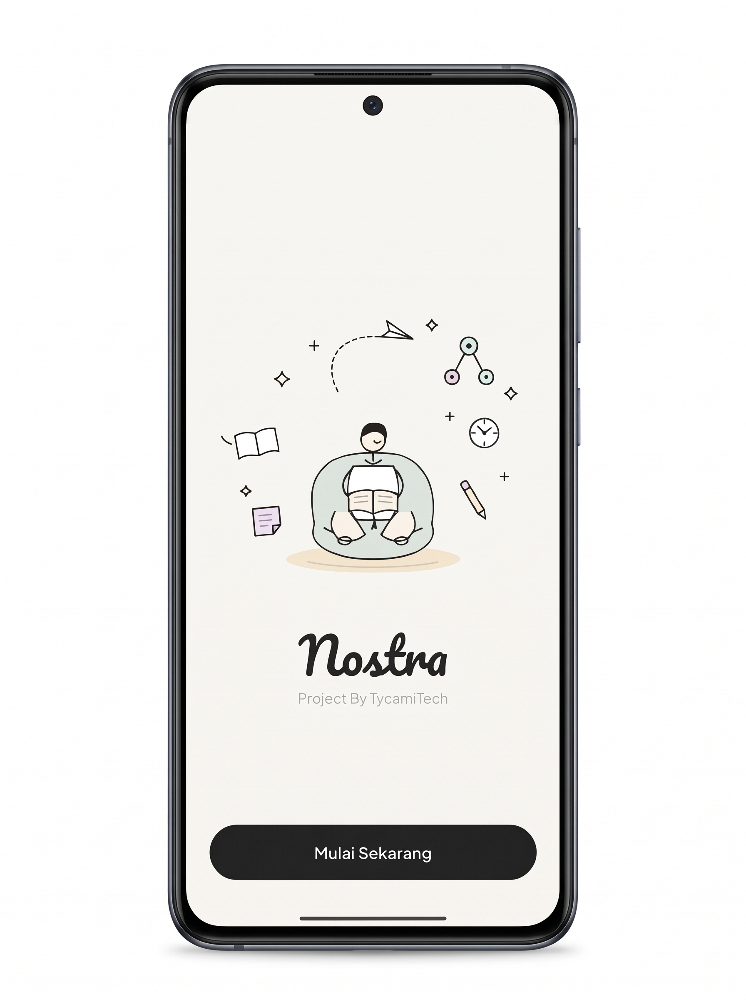
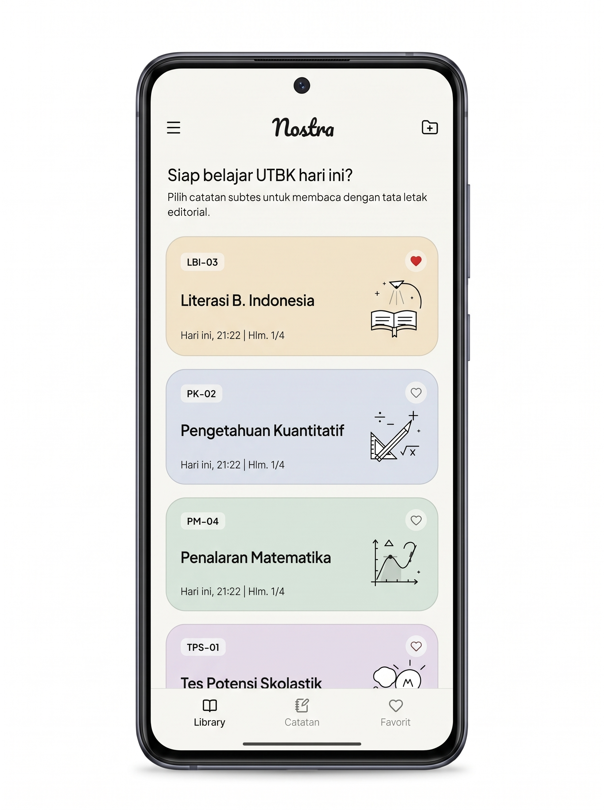
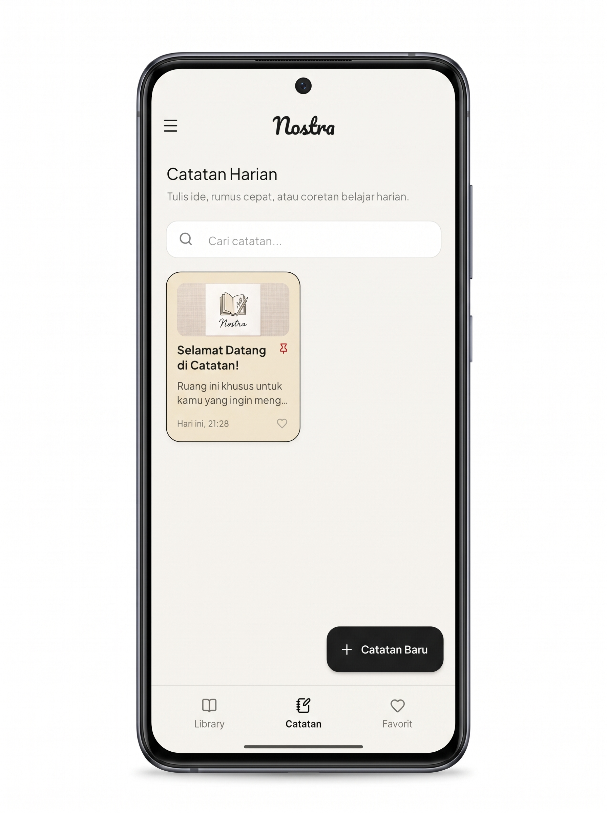
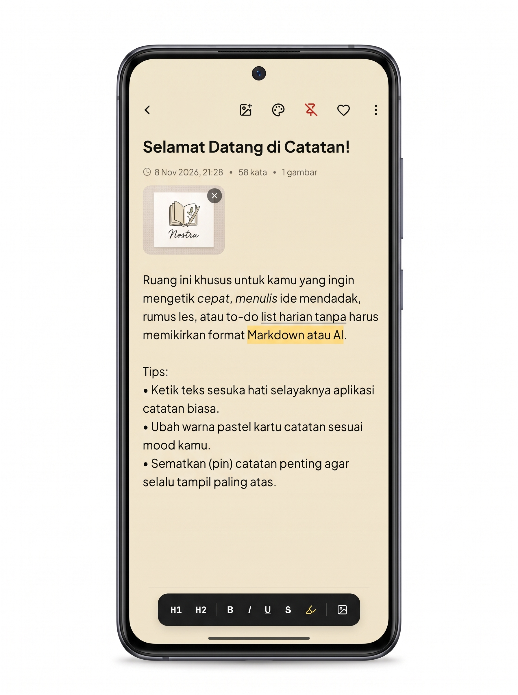
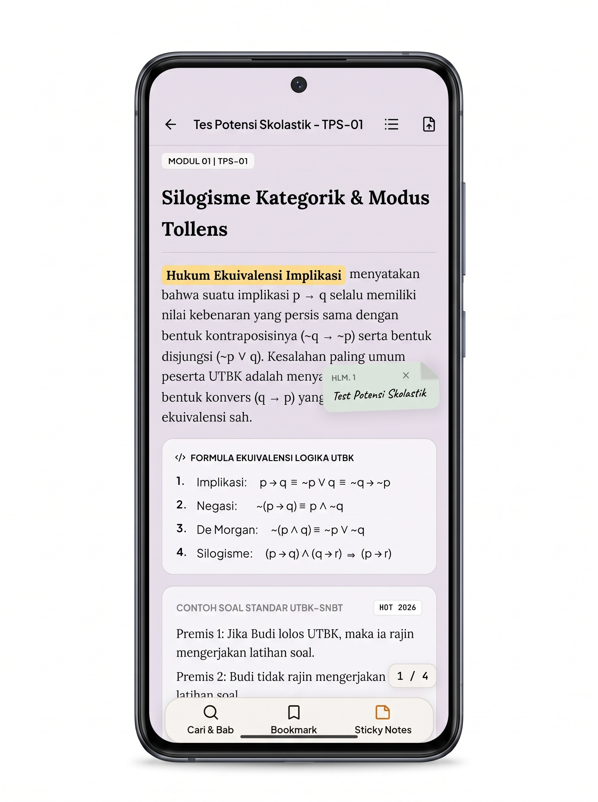
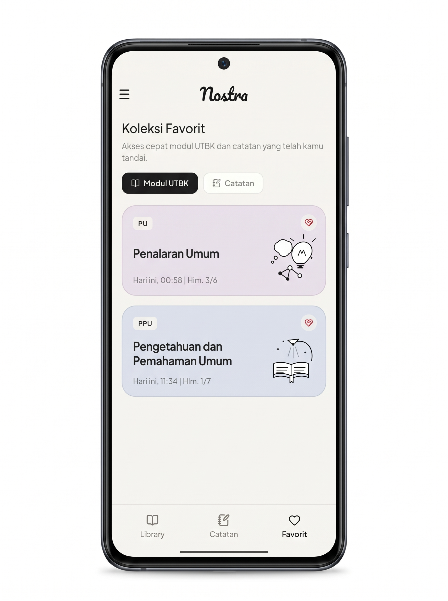
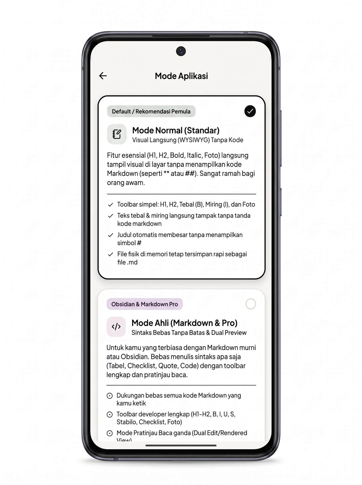
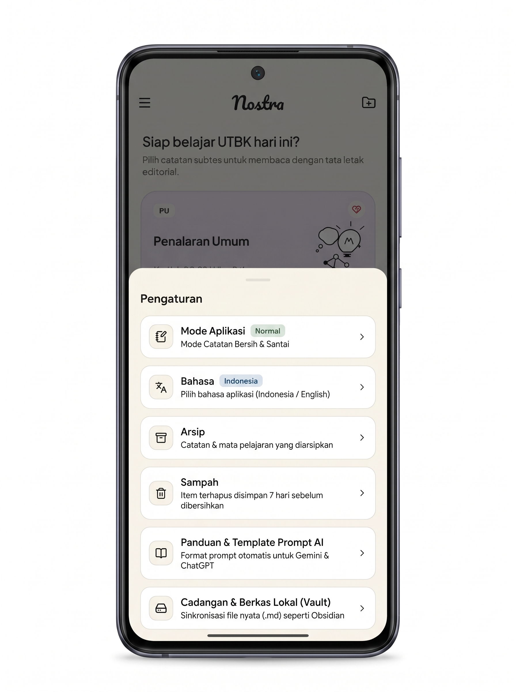
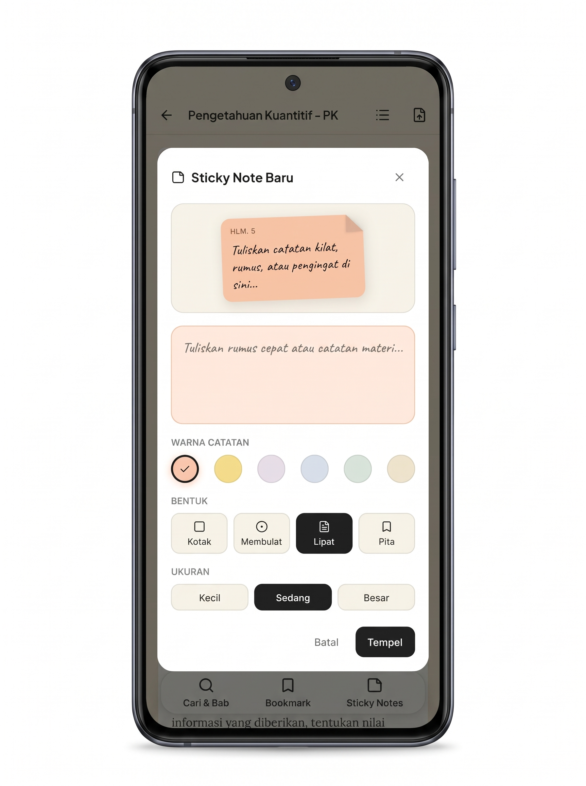
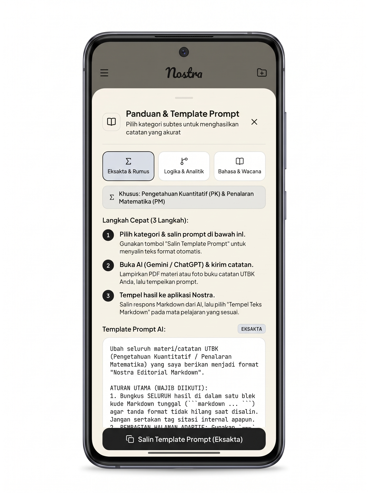

# Nostra ✍️📖

<p align="center">
  
</p>

<p align="center">
  <b>Minimalist Editorial Notes & Modular Study Deck for Modern Learners.</b><br>
  <i>Crafted with care by <b>TycamiTech</b></i>
</p>

<p align="center">
  
  
  
  
  
  
</p>

---

## 💡 About Nostra

**Nostra** menjembatani kesederhanaan aplikasi catatan harian (*Google Keep*) dengan kedaulatan data berbasis file Markdown (*Obsidian*), dibalut dalam estetika tata letak majalah editorial yang tenang dan berkelas (*Warm Editorial Design*).

Nostra dirancang khusus bagi pelajar, mahasiswa, dan pemikir yang lelah dengan *infinite vertical scrolling*. Melalui pendekatan **paginasi horizontal modular**, materi belajar terpecah menjadi bab-bab terfokus yang nyaman dibaca berjam-jam tanpa distraksi visual.

---

## 📱 Visual Showcase & Key Features

<table>
  <tr>
    <td width="50%" align="center">
      <h3>🚀 Onboarding & Splash</h3>
      <br>
      <i>Pengenalan visual yang ramah dengan ilustrasi editorial dan identitas hangat.</i>
    </td>
    <td width="50%" align="center">
      <h3>📚 Modular Study Decks</h3>
      <br>
      <i>Organisasi materi per subtes & mata pelajaran dalam kartu bernuansa pastel.</i>
    </td>
  </tr>
  <tr>
    <td width="50%" align="center">
      <h3>📝 Quick Daily Notes</h3>
      <br>
      <i>Catatan harian instan ala Google Keep dengan pin prioritas dan pencarian kilat.</i>
    </td>
    <td width="50%" align="center">
      <h3>✍️ Visual WYSIWYG Editor</h3>
      <br>
      <i>Pengetikan langsung ramah pemula tanpa kode rumit, dilengkapi toolbar format lengkap.</i>
    </td>
  </tr>
  <tr>
    <td width="50%" align="center">
      <h3>📖 E-Reader & 2D LaTeX Math</h3>
      <br>
      <i>Navigasi halaman geser (swiping), tipografi serif, rumus KaTeX, dan callout modul.</i>
    </td>
    <td width="50%" align="center">
      <h3>❤️ Koleksi Favorit & Bookmark</h3>
      <br>
      <i>Akses cepat materi penting dan catatan favorit dengan filter kategori terpisah.</i>
    </td>
  </tr>
  <tr>
    <td width="50%" align="center">
      <h3>🔄 Dual-Engine App Modes</h3>
      <br>
      <i>Fleksibilitas penuh: Mode Normal (WYSIWYG) untuk pemula & Mode Ahli (Obsidian Markdown).</i>
    </td>
    <td width="50%" align="center">
      <h3>⚙️ Pengaturan & Local Vault</h3>
      <br>
      <i>Pusat kontrol bahasa (ID/EN), arsip modul, tempat sampah 7 hari, dan sinkronisasi vault.</i>
    </td>
  </tr>
  <tr>
    <td width="50%" align="center">
      <h3>📌 Interactive Sticky Notes</h3>
      <br>
      <i>Tempelkan catatan kilat interaktif dengan pilihan warna pastel, bentuk lipat, dan ukuran.</i>
    </td>
    <td width="50%" align="center">
      <h3>🤖 Built-in AI Prompt Engine</h3>
      <br>
      <i>Template prompt 1-klik untuk ChatGPT & Gemini yang menghasilkan struktur Markdown siap pakai.</i>
    </td>
  </tr>
</table>

---

## 🌟 Fitur Unggulan

### 1. 🔄 Dual-Engine Mode (Casual vs Power-User)
- **Mode Normal (Standar)**: Pengalaman menulis cepat & ramah pemula (WYSIWYG). Menampilkan teks tebal (*bold*), miring (*italic*), stabilo (*highlight*), dan checklist secara visual tanpa menampilkan simbol Markdown mentah (`**`, `##`, `- [ ]`).
- **Mode Ahli (Markdown & Pro)**: Dukungan sintaks Markdown murni tanpa batas untuk pengguna terbiasa dengan Obsidian / developer, lengkap dengan toolbar sintaks cepat dan pratinjau ganda (*dual preview*).

### 2. 📖 Editorial Study Deck & Horizontal Reader
- **Horizontal Page Swiping**: Navigasi halaman per bab ala buku fisik (120fps smooth gesture) yang meningkatkan retensi memori visual dan fokus belajar.
- **2D LaTeX Formula Rendering**: Dukungan persamaan matematika kompleks baik inline (`$...$`) maupun blok multi-baris (`$$...$$`), pecahan, matriks (`\begin{bmatrix}`), sistem persamaan (`\begin{cases}`), dan simbol logika (`\wedge`, `\vee`, `\Rightarrow`).
- **Structured Editorial Callouts**: Kotak peringatan soal (`:::soal`), metode kilat (`:::metode`), tips trik (`:::tips`), dan jebakan opsi (`:::peringatan`).

### 3. 📌 Spatial Floating Sticky Notes
- Tempelkan memo mengambang langsung di atas halaman materi yang sedang dipelajari.
- Kustomisasi lengkap: palet warna pastel, gaya bentuk (Kotak, Membulat, Lipatan Sudut, Pita), dan ukuran.
- Bebas digeser (*draggable*) ke sudut mana saja di halaman buku.

### 4. 🤖 AI Prompt Guide & Automatic Importer
- Generator prompt terstruktur untuk model AI terkemuka (ChatGPT, Gemini, Claude).
- Kategori terkurasi:
  - **Eksakta & Rumus**: Pengetahuan Kuantitatif (PK) & Penalaran Matematika (PM).
  - **Logika & Analitik**: Silogisme kategorik, modus tollens, tabel kebenaran.
  - **Bahasa & Wacana**: Literasi Bahasa Indonesia & Bahasa Inggris.
- Salin prompt dengan 1-klik, kirim bersama materi modul Anda, dan tempel langsung ke Nostra untuk otomatis diformat menjadi deck modular siap baca.

### 5. 🗄️ Obsidian-Compatible Local Vault & Zero Lock-in
- **100% File Fisik Nyata**: Seluruh catatan dan dek modul disimpan sebagai berkas `.md` murni di penyimpanan lokal (`/Documents/Nostra/`).
- **YAML Frontmatter**: Metadata lengkap mencakup judul, subtes, waktu pembaruan, dan status pin.
- Dapat dibuka dan disinkronkan secara langsung menggunakan Obsidian, VS Code, Logseq, Markor, maupun teks editor desktop lainnya.

### 6. 🗃️ Arsip & Pemulihan Sampah Cerdas
- **Arsip**: Rapikan beranda dengan mengarsipkan dek lama tanpa menghapusnya dari database.
- **Sampah (Trash)**: Pengaman pemulihan (*restore*) tidak sengaja dengan pembersihan otomatis (*auto-purge*) setelah 7 hari.

### 7. 🌐 Bilingual Support (ID / EN)
- Penggantian bahasa sistem yang responsif secara *real-time* antara Bahasa Indonesia dan Bahasa Inggris pada seluruh antarmuka.

---

## 🛠️ Tech Stack & Dependencies

| Komponen | Teknologi | Keterangan |
| :--- | :--- | :--- |
| **Framework** | [Flutter](https://flutter.dev/) (Channel Stable, Dart 3) | Multiplatform Mobile Framework |
| **Local Database** | [Hive Flutter](https://pub.dev/packages/hive_flutter) | High-performance NoSQL local key-value storage |
| **Typography** | [Google Fonts](https://pub.dev/packages/google_fonts) | *Pacifico* (Brand Logo) & *Plus Jakarta Sans* (Editorial Body) |
| **Iconography** | [Lucide Icons](https://pub.dev/packages/lucide_icons_flutter) | Clean & minimal vector outline icons |
| **Math Engine** | `flutter_math_fork` | 2D LaTeX & KaTeX parser & rendering engine |
| **Storage & I/O** | `path_provider`, `file_picker` | Manajemen file sistem & direktori dokumen lokal |

---

## 📂 Struktur Proyek

```text
lib/
├── core/
│   ├── theme/
│   │   └── nostra_theme.dart          # Palet warna warm editorial, tipografi, & styling
│   └── widgets/
│       └── doodle_illustrations.dart   # Ilustrasi vektor & dekorasi kartu editorial
├── features/
│   ├── annotations/
│   │   ├── models/sticky_note.dart     # Model memo & koordinat posisi
│   │   └── presentation/               # Komponen floating sticky notes & sheet TOC
│   ├── backup/                         # Ekspor/impor Obsidian Vault lokal (.md)
│   ├── library/                        # Modul belajar, kartu subtes, & prompt guide
│   ├── notes/                          # Editor catatan WYSIWYG & Markdown ganda
│   ├── reader/                         # E-reader horizontal & Nostra Markdown Parser
│   └── settings/                       # Pemilih mode, bahasa, arsip, & sampah
└── main.dart                           # Inisialisasi Hive, routing, & App Entry Point
```

---

## 🚀 Panduan Memulai

### Prasyarat
- [Flutter SDK](https://docs.flutter.dev/get-started/install) (versi `>= 3.2.0`)
- Android SDK (dukungan API level 21+)
- Git

### Langkah Instalasi
1. **Clone repository ini**:
   ```bash
   git clone https://github.com/TycamiTech/Nostra.git
   cd Nostra
   ```

2. **Unduh dependencies**:
   ```bash
   flutter pub get
   ```

3. **Jalankan Automated Tests**:
   ```bash
   flutter test
   ```

4. **Jalankan Aplikasi di Emulator / Perangkat**:
   ```bash
   flutter run
   ```

---

## 📦 Mengompilasi Release APK

Untuk menghasilkan file APK produksi mandiri:

```bash
flutter build apk --release
```

Hasil kompilasi APK siap pasang akan tersedia di direktori:  
📁 `build/app/outputs/flutter-apk/app-release.apk`

---

## 📄 Lisensi

Proyek ini didistribusikan di bawah lisensi **MIT License**. Lihat berkas [LICENSE](LICENSE) untuk informasi selengkapnya.

---

<p align="center">
  <b>Nostra</b> • Dibuat dengan dedikasi oleh <b>TycamiTech</b><br>
  <i>Empowering Focused, Distraction-Free Learning.</i>
</p>
